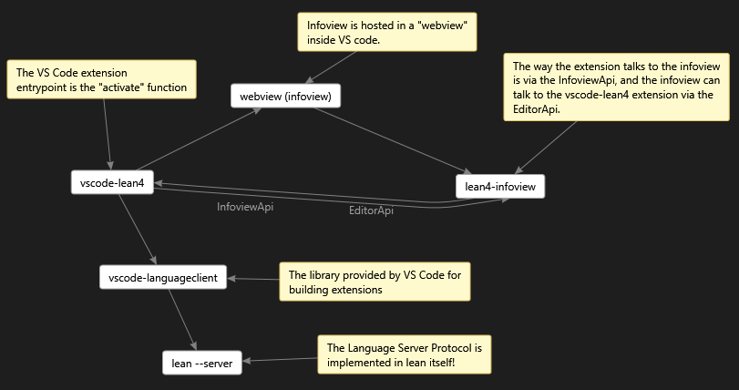

# Development

This page is designed for software developers who are helping to develop the Lean 4 VS Code extension.

The repository contains NPM packages implementing editor integration for the Lean 4 programming language. The VS Code
extension proper is in [`vscode-lean4`](../vscode-lean4/), while [`lean4-infoview`](../lean4-infoview/) implements the
information display. The API glue code between them is in [`lean4-infoview-api`](../lean4-infoview-api/). We build
the packages in tandem using NPM workspaces.



### Building
- Make sure you have an up to date installation of `npm` and `node.js`.  For example `npm` version 8.1.3 and `node.js` version v16.13.0.
- Run `npm install` in your workspace root folder to set up the project's dependencies.
- Run `npm run build`. This compiles the extension.

### Testing
- Make sure you have executed the above build steps
- Run `npm run test`. If you want to see incremental output, run this in the `vscode-lean4` folder.
- See [the test README](../vscode-lean4/test/README.md) for more information.

### Debugging
- Complete the 'Building' instructions above.
- Open VS Code on this folder.
- Press <kbd>Ctrl</kbd>+<kbd>Shift</kbd>+<kbd>B</kbd> to compile the extension. (<kbd>Cmd</kbd>+<kbd>Shift</kbd>+<kbd>B</kbd> on macos.) This step is needed for a working development setup.
- Press <kbd>F5</kbd> to launch the extension in the VS Code debugger.

To debug the tests, use the launch configuration named `Extension Tests - SuiteName`.

#### React DevTools for the InfoView
Development builds of the extension automatically attempt to connect the InfoView
to [React DevTools](https://react.dev/learn/react-developer-tools) on `http://localhost:8097`
(or a different port if the `DEV_SCRIPT_PORT` environment variable is set).

1. Start the standalone React DevTools app in a terminal. (Even if developing `vscode-lean4` remotely over SSH, do this on your local machine.)
   ```bash
   npx react-devtools
   ```
2. Build and launch the extension in development mode (e.g. via <kbd>F5</kbd>).
3. Open the InfoView (or run `Developer: Reload Webviews` if it was already open). Its component tree should appear in the React DevTools window.

## Packaging

To publish the extension on the VS Code marketplace you should run the `./release.sh` script. See [publishing extensions](https://code.visualstudio.com/api/working-with-extensions/publishing-extension) for more information.

You can build a local .vsix for testing using `npm run package` in the `vscode-lean4/` subdirectory. This gives you a .vsix which you can install using the VS Code command `Extensions: Install from VSIX...`.
